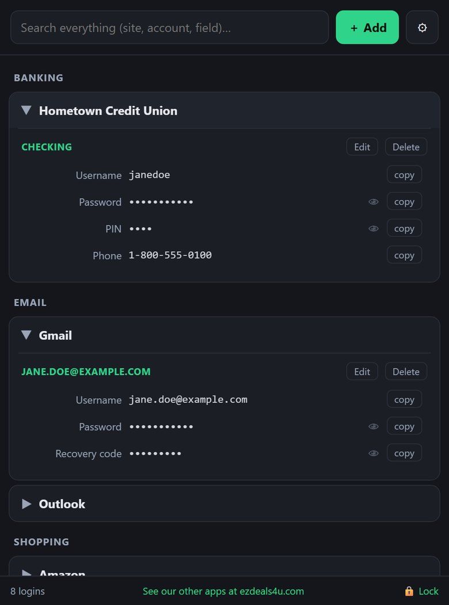
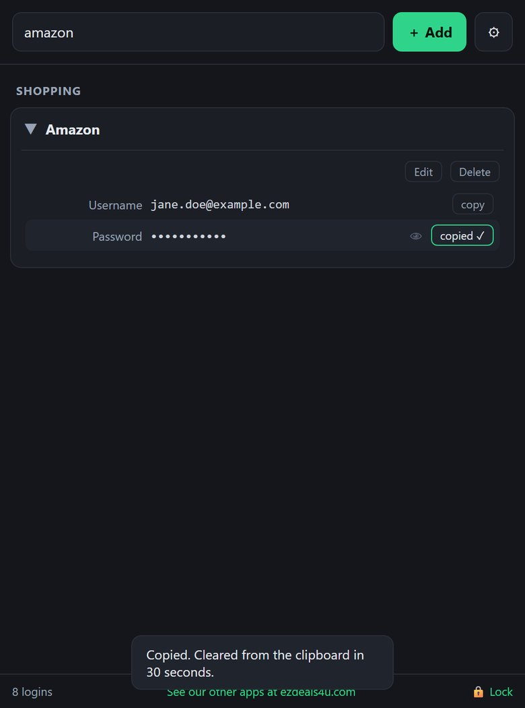
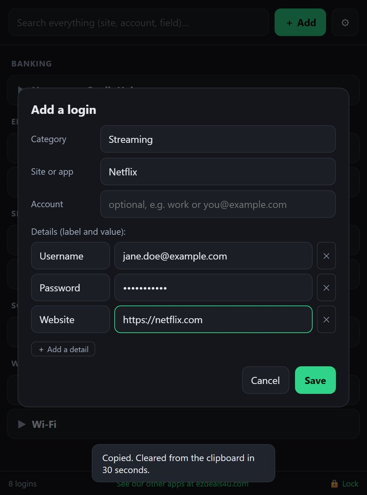
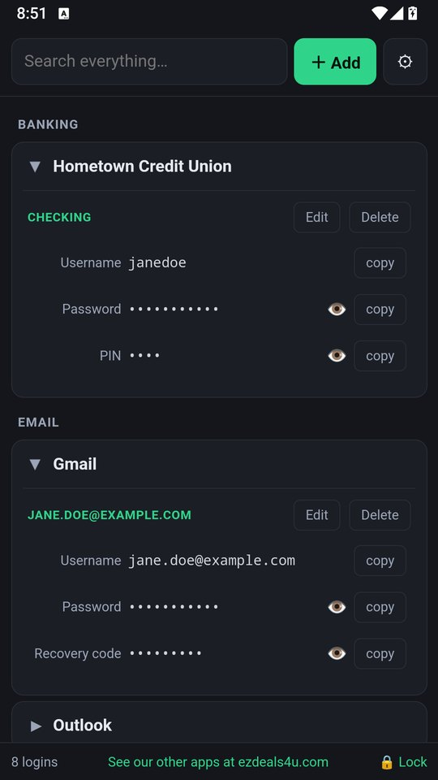

# ZapKey: free password organizer for Windows and Android

Every login you have, in one place, behind one master password. No account, no cloud, no ads.

## Download

| | File | Size | SHA-256 |
|---|---|---|---|
| **Windows** 10 / 11 | [ZapKey-Setup-1.0.0.exe](https://github.com/nickmeet282/zapkey/releases/latest) | 18 MB | `5b91479d06206a28a127797b8f6602e5d4d48f4c5eddcb748c9ea284c88a3611` |
| **Android** 8+ | [ZapKey-1.0.0.apk](https://github.com/nickmeet282/zapkey/releases/latest) | 181 KB | `ccb9eb853c699b3c1693bb4362b5594137e1ab38bf22585d1da8131dcb2e0620` |

Also on the official page: **https://ezdeals4u.com/zapkey**

## What it does

- **Find any login in a second.** Search covers sites, accounts and every saved detail.
- **Copy with one click.** The clipboard is cleared 30 seconds later.
- **Save more than passwords:** PINs, recovery codes, Wi-Fi keys, security answers, with your own labels.
- **Import** from Chrome, Edge, Firefox or Bitwarden CSV exports.
- **Locks itself:** after 15 minutes idle on Windows, a minute after you leave the app on Android.
- **PC and phone, same vault:** save a backup on one, restore it on the other. It stays encrypted the whole way.

## Privacy

- Your logins are stored only in one encrypted file on your own device. There is no ZapKey account or server.
- Encryption: scrypt key derivation (N=2^17, r=8, p=1) and Fernet (AES-128-CBC with HMAC-SHA256).
- **The Android app requests no permissions at all**, including no internet access. Files move only through the system file picker when you choose Backup, Restore or Import.
- The Windows app goes online for one thing only: reading a small version file on ezdeals4u.com to tell you about updates. It sends nothing about you or your logins.
- Copied values are kept out of Windows clipboard history and cloud clipboard, and marked sensitive on Android. Android screenshots of the app are blocked.
- No ads, no tracking, no analytics.

**Write your master password down somewhere safe.** If you forget it, nobody can open your vault, not even us.

## Installing

**Windows:** run the installer. If Windows shows "Windows protected your PC", click **More info**, then **Run anyway**. That's normal for apps from small studios.

**Android:** download the APK on your phone, tap it, and allow installs from your browser if your phone asks.

## Screenshots

  

*Screenshots show made-up demo logins.*

## About

ZapKey is free from [EZDeals4U](https://ezdeals4u.com), maker of tested Windows apps you pay for once and keep. Questions: support@ezdeals4u.com
